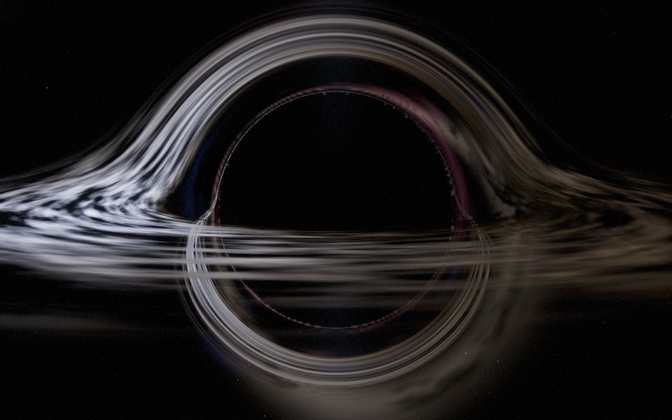
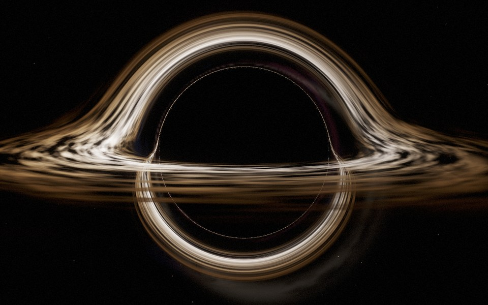
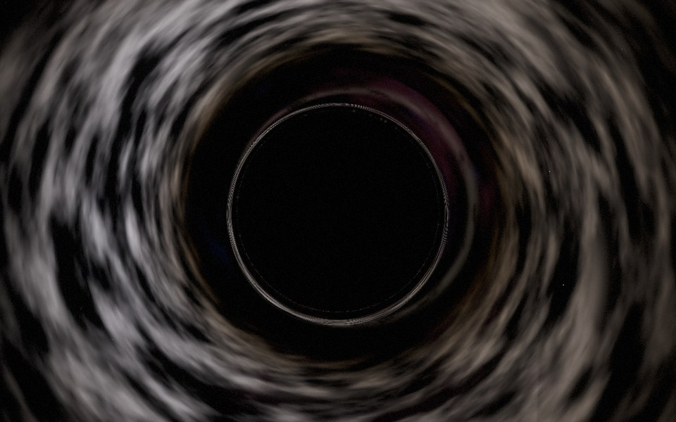
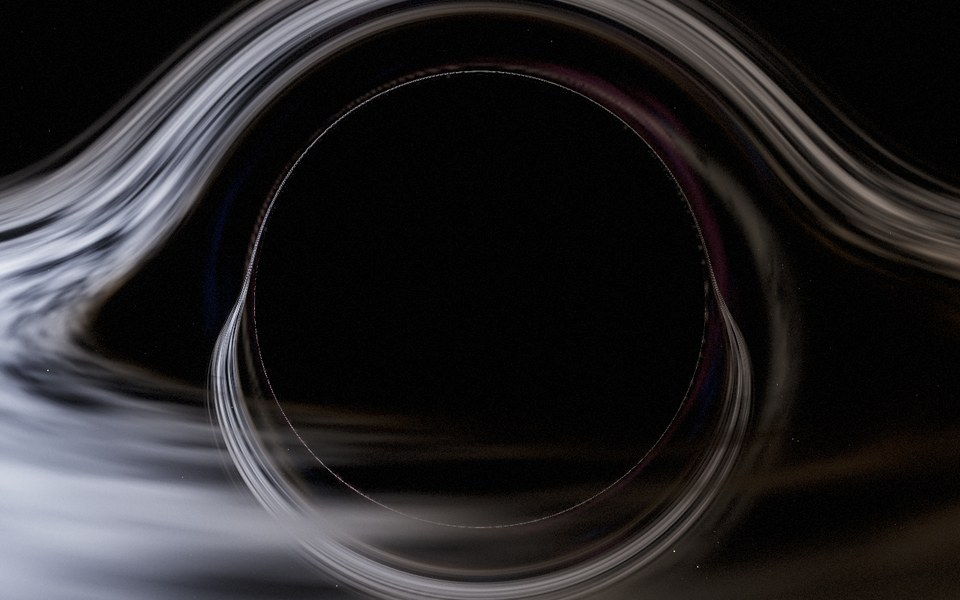
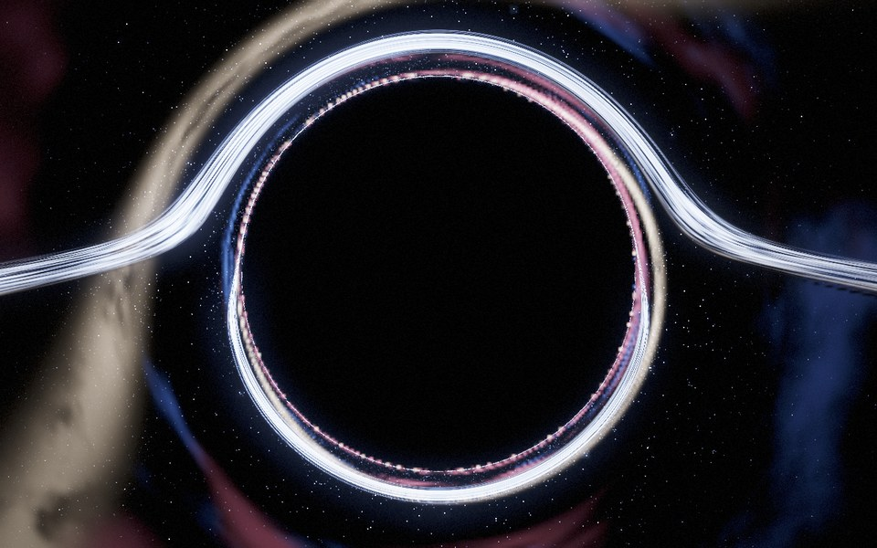
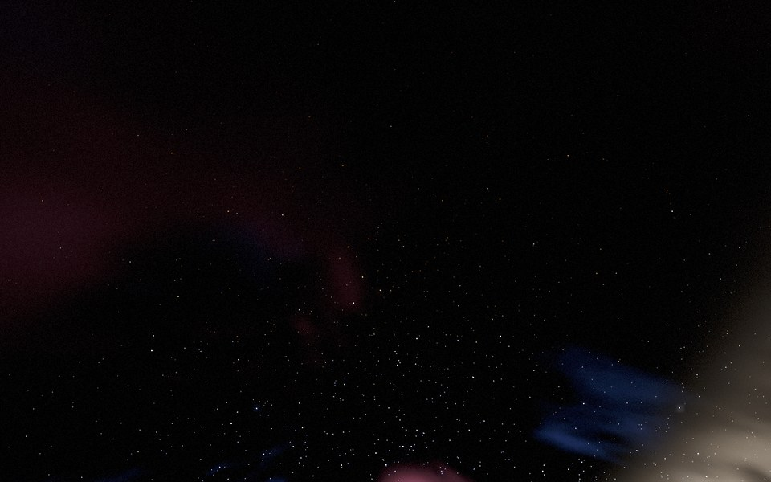

# Black hole: physics and visual targets

`blackHole()` renders a non-spinning (Schwarzschild) black hole with a thin accretion disk, a lensed star field and Milky Way, orbiting hot spots, an optional jet glow, and an observer who can fall through the horizon. Everything is computed in the `no_std` Rust core (`crates/anikit-core/src/blackhole.rs`) and exposed through WebAssembly. This page is the spec: the physics the renderer implements, what it approximates, and the references it is checked against.

Units are geometric, G = c = M = 1, so lengths are in black-hole masses M (for Sgr A*, 1 M ≈ 6.2 × 10⁶ km ≈ 20 light-seconds).

## Key radii and angles

| Quantity | Value | Where it shows |
|---|---|---|
| Event horizon | r = 2M | Inside it every future-directed path falls inward. |
| Photon sphere | r = 3M | Circular light orbits (unstable). |
| Critical impact parameter | b_c = 3√3 M ≈ 5.196M | Edge of the shadow; the photon ring. The ring is ≈ 10.4M across seen from far away. |
| ISCO | r = 6M | Inner edge of a thin disk (innermost stable circular orbit). |
| Shadow seen by a static observer at r | sin ψ_c = (b_c / r)·√(1 − 2M/r) (Synge 1966) | Unit-tested against the table (to 2 × 10⁻³ rad). |

The Event Horizon Telescope images of M87* (EHT 2019, Paper I) and Sgr A* (EHT 2022) show a bright ring with a diameter of about 11M (close to the 2√27 M ≈ 10.4M critical curve, widened by emission just outside it), brighter on one side. That asymmetry is relativistic beaming of the gas moving toward us. These two features, ring size and one-sided brightness, are the main physical targets.

## Light bending: the geodesic table

Every photon orbit around a Schwarzschild hole lies in a plane through the centre. With u = 1/r and φ the angle in that plane, the orbit obeys the Binet equation

  d²u/dφ² + u = 3M u²,   with (du/dφ)² = 1/b² − u²(1 − 2Mu)

where b = L/E is the impact parameter. For a given observer, a pixel's ray is fixed by one angle: ψ, the angle between the viewing direction and the direction to the hole, measured in the observer's own frame. The renderer integrates 1536 rays (ψ from 0 to the largest angle on screen) with RK4 at a step of π/128 in φ. It stores u(φ) for φ ∈ [0, 4π] (a 1536 × 514 table) and the asymptotic escape angle φ∞ of each ray, found by interpolating where u crosses zero. A ray is *captured* once it crosses r = 2M inward. The table is rebuilt only when the distance, the infall state or the field of view changes.

**Per pixel** (rebuilt only when the camera changes), the orbit plane is spanned by ĉ (the unit vector from the hole to the observer) and ŝ (the pixel's direction projected perpendicular to ĉ). A point on the ray is r(φ)(cos φ ĉ + sin φ ŝ), so the ray crosses the disk plane z = 0 at φ_k = φ₀ + kπ with tan φ₀ = −ĉ_z / ŝ_z. Because the table has 128 columns per π, the crossings are fixed column offsets:

- **k = 0**: the direct image of the disk;
- **k = 1**: the secondary image, the far side of the disk lensed over the top of the shadow and under its bottom (the "Interstellar" arc; Luminet 1979, figure 11);
- **k = 2**: the thin photon ring hugging the shadow.

Higher orders are exponentially thinner (each is demagnified by about e^π ≈ 23; Gralla, Holz & Wald 2019; Johnson et al. 2020) and fall below a pixel.

Each crossing that lands on the disk becomes a *sample* carrying a precomputed base radiance. Rays that never hit the disk (or pass through gaps in it) escape in the direction cos φ∞ ĉ + sin φ∞ ŝ and sample the lensed sky.

## The disk: temperature, redshift, beaming

**Temperature.** A thin, optically thick disk radiates locally as a blackbody with the Novikov–Thorne flux. For Schwarzschild, Page & Thorne (1974) give, with x = √r:

  F(r) ∝ [1 − √(6/r) + (√3 / 2√r) · ln( (x + √3)(√6 − √3) / ((x − √3)(√6 + √3)) )] / (r²(r − 3))

F = 0 at the ISCO, the flux peaks at r ≈ 9.55M (unit-tested), and T(r) = T_peak (F/F_max)^¼. The default T_peak is 9000 K in the physical mode. Real supermassive-hole disks peak in the UV (10⁵ K); the renderer scales T_peak down to the visible, as DNGR did for *Interstellar*.

**Redshift.** For gas on a circular Keplerian orbit, Ω = √(M/r³), and a photon with L_z/E = λ, the ratio of observed to emitted frequency is

  g = D_obs · √(1 − 3M/r) / (1 − Ω λ)

The factor √(1 − 3M/r) combines gravitational redshift with transverse Doppler; 1/(1 − Ωλ) is the line-of-sight Doppler shift; D_obs = ε_obs/E converts the photon's conserved energy into the energy the observer measures (1 for a static observer far away). It is unit-tested against this closed form, and against √(1 − 3/r) face-on.

**Colour and beaming.** Since I_ν/ν³ is invariant along a ray, a blackbody at T seen with shift g is exactly a blackbody at g·T: I_ν^obs(ν) = B_ν(ν; gT). Its bolometric intensity therefore scales as g⁴T⁴. The renderer reads linear-sRGB radiance from a 1024-entry table of blackbody colours over log T (600 K to 100 000 K). The table integrates Planck's law against the CIE 1931 colour-matching functions (the Wyman, Sloan & Shirley 2013 analytic fit), then converts XYZ to linear sRGB, desaturating out-of-gamut colours toward their luminance. The approaching side comes out brighter and bluer, the receding side dim and red.

**Modes.**

- `'physical'`: Doppler colour plus g⁴ beaming, as above. This is the Luminet / EHT look.
- `'cinematic'`: *Interstellar*. James et al. (2015) describe how the film's disk omitted the Doppler colour shift and most of the beaming ("the image would have been confusing to the audience"), giving the familiar symmetric, warm golden ring. The cinematic mode colours by rest-frame T, uses intensity ∝ g^1.5 instead of g⁴, and gives the temperature profile a hot inner rim (T ∝ r^−¾) instead of the zero-torque fall-off.

**Texture and motion.** Turbulence is a static, anisotropic, periodic fbm texture in (ln r, azimuth): finer radially than in azimuth, so differential rotation draws it into filaments. Each frame the core builds a 256 × 1024 density texture by sampling it at azimuth − Ω(r)·t. That is pure Keplerian shear, so inner rings lap outer ones. To keep the shear from winding the pattern into rings, two copies with different random offsets cross-fade on a triangle schedule (period 70M). Each copy is reset only while its weight is zero, so the flow is continuous in time (unit-tested). The per-sample cost is then one bilinear texture lookup.

**Hot spots.** Five compact flares are born at random radii between 6.6M and about 14M, live for 260M (one to two orbits), and fade in and out. Each is a Gaussian in (ln r, azimuth) whose centre at radius r moves at that radius's Ω(r), so it shears into an arc exactly as the gas does. These model the orbiting near-ISCO flares GRAVITY observed around Sgr A* (GRAVITY Collaboration 2018).

**Infalling streams.** Two trailing spiral streams wind in from the outer edge. Each is carried around at the local orbital speed (so it winds up as real streams do) and has clumps sliding inward along it. Each lives 420M and fades in and out. Hot spots and streams both scale with `hotSpots`.

**Opacity.** Each crossing has opacity 0.97 × the density (0.92 in cinematic mode), faded at the inner edge (near the ISCO) and the outer edge. Crossings are composited front to back (k = 0, then 1, then 2, then the sky), so gaps in the disk reveal the lensed arc behind it.

## Stars and sky

**Star catalogue.** The catalogue holds 9000 stars: 45 % in a tilted Milky-Way band, the rest isotropic. Counts follow N(<m) ∝ 10^0.5m between m = −1 and 8.5, with colour temperatures from 3200 K to 30 000 K, weighted toward cool stars. Each frame, every star is *inverted through the lens* rather than ray-traced. A star at angle θ from ĉ is seen along rays whose escape angle is φ∞ = θ (the primary image), 2π − θ (the secondary image, on the opposite side of the hole) or 2π + θ. φ∞(ψ) is monotonic over the escaping rays, so a binary search over the table gives ψ exactly. The star is splatted as a bilinear 2 × 2 point. Its flux is multiplied by the solid-angle magnification μ = (sin ψ dψ)/(sin θ dθ) (capped at 40) and by D_obs⁴, and its colour is the blackbody at D_obs·T. Stars slide around the Einstein ring and brighten as they approach it, as real lensed stars do.

**Milky Way and nebulae.** A 1024 × 512 panorama of faint fbm nebulae and a dusty Milky-Way band is looked up at quarter resolution through each low-resolution pixel's escape direction, attenuated by the disk's transmittance and D_obs³, and composited with the bloom.

## Falling in

The observer can hover (`fall: 0`, a static observer, who must stay outside the horizon) or fall freely from rest at infinity (`fall: 1`, the Painlevé–Gullstrand "raindrop" of Hamilton & Lisle 2008, moving inward at v = √(2M/r) relative to static observers). Values in between blend the speed.

- **Outside the horizon**, the viewing angle ψ in the moving frame becomes the static-frame angle α by relativistic aberration, cos α = (cos ψ − v)/(1 − v cos ψ). Then b = r sin α / √(1 − 2M/r), du/dφ = u √(1 − 2Mu) cot α, and D_obs = sin α / (sin ψ √(1 − 2M/r)).
- **Inside the horizon**, static observers do not exist; the raindrop frame is used directly. With β = √(2M/r) the photon has E = ε(1 − β cos ψ) and L = εr sin ψ, so b = r sin ψ/(1 − β cos ψ), du/dφ = u(cos ψ − β)/sin ψ and D_obs = 1/(1 − β cos ψ). At β = v these agree with the outside formulas; that is unit-tested at r = 5M. Rays with E ≤ 0 (looking downward inside the horizon) cannot have come from outside and are drawn black. The others stream in from above.

The result is what Hamilton's *Inside black holes* visualisations show. As you fall, the shadow grows to fill the view ahead, while the outside universe, the disk's lensed images and the stars are compressed by aberration into a shrinking bright patch behind and above, blue-shifted ahead and red-shifted behind. After you cross r = 2M, the outside sky is still visible above you; below is black.

Approximation: the interior uses the Schwarzschild metric, i.e. an eternal, non-rotating, uncharged hole. A real (rotating) hole's inner horizon and mass-inflation instability (Hamilton 2010–2011) are not modelled.

## Image pipeline and performance

- **HDR planes.** Linear radiance is accumulated in f32 planes, with a separate transmittance plane.
- **Bloom.** A 4 × 4 downsample, then a tight and a wide iterated box blur (≈ Gaussian) at quarter resolution. The lensed sky is added at the same resolution.
- **Tone map.** The ACES filmic fit (Narkowicz 2015) runs in `f32x4` SIMD, followed by an sRGB lookup table and mid-tone-weighted film grain, giving RGBA8.
- **Cost split.** Moving the camera (distance, inclination, field of view, look, fall) rebuilds the table and the per-pixel geometry. Animating `time` or orbiting with `azimuth` reuses them: a frame is then one texture build, one lookup per disk sample, the star inversion, bloom and tone map.

Benchmarks are in `packages/anikit/scripts/bench-blackhole.mjs` (wasm in Node) and `cargo run --release -p anikit-core --features std --example blackhole` (native, with per-stage timings, and reference PPMs when given an output directory). `examples/blackhole.html` is the scroll journey; add `?p=0.5` to pin the progress, `&mode=cinematic`, `&scale=0.75` or `&budget=0`.

## Reference renders

| | |
|---|---|
|  84°, 30M, physical: the approaching side is brighter and bluer, the receding side dim and orange; the far side is lensed over and under the shadow. |  The same view, cinematic (*Interstellar*) mode. |
|  17°, 40M: the near-face-on, EHT-like view; a photon ring of radius ≈ √27 M. |  10M, 80°, field of view 70°. |
|  Falling (raindrop), 2.2M: the shadow fills the view, the disk and sky are squeezed into a ring. |  Inside the horizon (1.5M), looking up and back: the aberrated, redshifted outside sky. |

## References

- O. James, E. von Tunzelmann, P. Franklin, K. S. Thorne, "Gravitational lensing by spinning black holes in astrophysics, and in the movie *Interstellar*", *Class. Quantum Grav.* 32, 065001 (2015), arXiv:1502.03808.
- J.-P. Luminet, "Image of a spherical black hole with thin accretion disk", *Astron. Astrophys.* 75, 228–235 (1979).
- Event Horizon Telescope Collaboration, "First M87 Event Horizon Telescope Results. I. The Shadow of the Supermassive Black Hole", *ApJL* 875, L1 (2019); "First Sagittarius A* Event Horizon Telescope Results. I.", *ApJL* 930, L12 (2022).
- I. D. Novikov, K. S. Thorne, "Astrophysics of black holes", in *Black Holes (Les Astres Occlus)*, Gordon & Breach (1973); D. N. Page, K. S. Thorne, "Disk-accretion onto a black hole. Time-averaged structure of accretion disk", *ApJ* 191, 499 (1974).
- J. L. Synge, "The escape of photons from gravitationally intense stars", *MNRAS* 131, 463 (1966).
- S. E. Gralla, D. E. Holz, R. M. Wald, "Black hole shadows, photon rings, and lensing rings", *Phys. Rev. D* 100, 024018 (2019); M. D. Johnson et al., "Universal interferometric signatures of a black hole's photon ring", *Sci. Adv.* 6, eaaz1310 (2020).
- A. J. S. Hamilton, J. P. Lisle, "The river model of black holes", *Am. J. Phys.* 76, 519 (2008); A. J. S. Hamilton, *Inside black holes* (JILA, University of Colorado), visualisations of falling through the horizon.
- GRAVITY Collaboration, "Detection of orbital motions near the last stable circular orbit of the massive black hole SgrA*", *A&A* 618, L10 (2018).
- C. Wyman, P.-P. Sloan, P. Shirley, "Simple analytic approximations to the CIE XYZ color matching functions", *JCGT* 2(2) (2013).
- K. Narkowicz, "ACES filmic tone mapping curve" (2015).

## Status

*As of 2026-11-16, 14:35 UTC, branch `claude/epic-ramanujan-qe7x4w-blackhole`.*

**Done**

- **Core** (`crates/anikit-core/src/blackhole.rs`) implements everything above: the geodesic table, the per-pixel lensing geometry with three image orders, the Page–Thorne disk with exact g, blackbody colour and g⁴ beaming, both modes, the flowing sheared turbulence, hot spots, lensed stars (inverted through the lens, with magnification), the lensed Milky Way and nebulae, a jet glow, the infalling (raindrop) observer inside and outside the horizon, bloom, ACES tone mapping and grain.
- **Unit tests** cover: the shadow edge at b = 3√3 M from far away; the Synge shadow angle at 10M and 30M; periapsis ≈ 3M for the critical ray; the ISCO and Page–Thorne peak; g against the analytic formula; raindrop against static-plus-aberration; blackbody colours; continuity of the turbulence in time (across resets too); fast log2/sincos accuracy; and an end-to-end render.
- **WebAssembly**: `ak_bh_create/free/resize/render/stats` (parameters through the f64 scratch buffer, output pointer into a stable RGBA buffer), plus `ak_bh_stage` for per-stage profiling.
- **TypeScript**: `blackHole({ width, height, canvas, mode, scale, seed, budget, minScale })` returns `render(frame)`, `resize`, `stats`, `currentScale` and `destroy/kill/revert`. It is registered with `track()`, has `OptionKeys` tables with unknown-key warnings, JSDoc, a type-checked example in `docs/api.md` and vitest tests.
- **Python**: `anikit.BlackHole(width, height, mode)` with `render(**params)` returning RGBA bytes, `resize`, `stats` and `size`; pytest passes.
- **Demo and benchmark**: the demo page is `examples/blackhole.html`; the benchmark is `packages/anikit/scripts/bench-blackhole.mjs`.

**Performance** (measured on this sandbox VM, which is slow: a plain 1M-element `Float32Array` multiply–add loop in Node takes about 2.5 ms here, roughly 3–4× a current laptop):

| 1280×800 (1.02 Mpx) | Node wasm, steady (time + azimuth animating) | Node wasm, camera moving | Chromium headless, incl. `putImageData` |
|---|---|---|---|
| scale 1, edge-on 30M | 24.6 ms | 100 ms | 29 ms |
| scale 0.75 | – | – | 16.4 ms |
| scale 0.6 | 10.4 ms | 41 ms | – |
| `budget: 14` (adaptive), mid-journey (7M) | – | – | 9.2 ms at 576×360 |

- **The ≤ 8 ms at 1 Mpx target is not met on this VM.** Steady frames are 24.6 ms in wasm here. If the 3–4× ratio above carries over, that would be roughly 6–8 ms on a current desktop, but this was not measured on one; it needs confirming on real hardware.
- **Camera moves are about 4× a steady frame.** Moving the camera re-integrates the table (about 4 ms) and rebuilds the per-pixel geometry. Orbiting with `azimuth` and animating `time` reuse the geometry.
- **The scroll journey should use `budget`** (for example 14 ms with `minScale: 0.5`). The scale then drops automatically while the camera moves and recovers once it settles.
- **Where the steady frame goes (wasm, per stage, ms):** disk texture 0.8, shading 8–9, stars 2, bloom and sky 4, tone map 12. Every stage is memory-bound on this VM.

**Not done, or approximated**

- **Spin.** The hole is non-rotating (Schwarzschild). A Kerr hole, with its frame dragging and the asymmetric, flattened shadow DNGR shows, would need a two-parameter geodesic table.
- **Thin disk only.** The disk has no vertical thickness and no volumetric optical depth, and there is no corona. The plunging region inside the ISCO is dark.
- **Jet.** It is a 2D glow along the projected axis at bloom resolution. It is not lensed or ray-marched.
- **Sky resolution.** The Milky Way and nebulae are looked up at quarter resolution. Stars are inverted per image (primary, secondary and one more winding) and splatted at full resolution.
- **Eye adaptation.** Looking back out from inside the horizon, the sky is physically dimmed (redshifted by about 1/(1 + β)). The renderer raises exposure there by up to 10× (eye adaptation) so the finale is visible.
- **Temperature scale.** Disk temperatures are scaled to the visible: 7000 K peak by default in physical mode, against about 10⁵ K for a real disk around a supermassive hole. Colours are therefore representative, not literal.
- **Performance.** It falls short of the stated target on this VM; see above. The remaining cost is per-pixel memory traffic: three HDR planes plus transmittance, roughly 16 bytes per disk sample, and the tone-map pass. Possible next steps: f16 or packed HDR, merging shading into the tone-map pass for the direct image, and computing camera-move geometry at half resolution.

