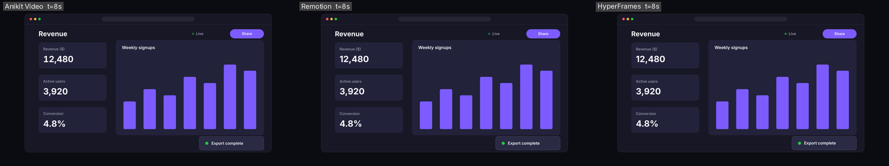
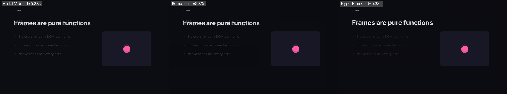

# Anikit Video: end-to-end benchmarks

How long it takes to go from a composition to a finished 1080p H.264 MP4, with Anikit Video and with the
browser-based tools agents use today (Remotion and HyperFrames), on the same machine, for the same three
videos. Everything here was measured by `bench/video/run.mjs`; nothing is estimated.

## The three compositions

(a)–(c) are 1920×1080, 30 fps, 20 s (600 frames); (d) is 60 fps, 60 s. All are, dark theme, bundled Inter (variable; "Inter Display" is Inter
at optical size 32 in every tool), with the same layout, colours, eases and timings in every tool.

| | Composition | What moves |
|---|---|---|
| (a) | **Kinetic type title sequence** (`kinetic`) | 4 hard-cut scenes; per-character staggered rises and pop-ins, sliding words, a line that grows, a rotating outline square; a slow camera push-in on every scene, so **every pixel changes on every frame**. |
| (b) | **Product UI** (`product`) | A browser-window frame, 3 stat cards with two counters, a 7-bar chart that builds and later updates, a pulsing "Live" dot, a toast that slides in and out, a cursor that moves to a button that presses. Moves in bursts; long stretches are nearly static. |
| (c) | **Held-heavy explainer** (`explainer`) | 4 slides with 0.5 s crossfades; title and three bullets fade up, then the slide holds while a small dot floats. **Mostly static frames.** |
| (d) | **Long** (`long`): **60 fps, 60 s** (3,600 frames) | (a) played three times back to back at 60 fps, to show how the gap behaves at length. Remotion: the same component with `times: 3` at `fps={60}`; HyperFrames: three nested instances of the kinetic composition (`data-composition-src`) in a 60 fps root; Anikit Video: the kinetic scenes listed three times with `"fps": 60`. |

Sources (each written idiomatically for its tool):

| Tool | Files |
|---|---|
| Anikit Video | `bench/video/anikit/{kinetic,product,explainer}.json` |
| Remotion | `bench/video/remotion/src/{Kinetic,Product,Explainer}.tsx` + `common.tsx`, `Root.tsx`, `index.ts` |
| HyperFrames | `bench/video/hyperframes/{kinetic,product,explainer}/index.html` + `bench/video/shared/base.css` (GSAP timelines) |

Side-by-side frames (Anikit Video | Remotion | HyperFrames, same time code, from each tool's lossless frames):
`bench/video/screens/*.png`, for example `kinetic-1.5s.png`, `product-8s.png`, `explainer-5.33s.png` (mid-crossfade).





## Results

<!-- results:start -->
Measured 2026-11-17 03:55 UTC on 4 vCPU (Intel(R) Xeon(R) Processor @ 2.10GHz), 16 GB RAM, Linux 6.18.44-fc-v553. Anikit `95d31cf`, Remotion 4.0.544, HyperFrames 0.9.59 (GSAP 3.15.1), React 19.3.1, Google Chrome for Testing 153.0.8010.12, ffmpeg version 6.1.1-3ubuntu5, Node v22.23.4. Each cell is the median of 3 runs. Compositions (a)–(c) are 600 frames (20 s at 30 fps), (d) is 3,600 frames (60 s at 60 fps), all 1920×1080.

### Headline: wall time to a finished 1080p H.264 MP4 (seconds, lower is better)

| Composition | Anikit Video (default) | Remotion (default) | HyperFrames (default) | Anikit Video vs fastest browser config |
|---|---:|---:|---:|---|
| (a) kinetic type | 1.37 | 26.7 | 29.8 | 10× faster than HyperFrames fast (14.1 s) |
| (b) product UI | 0.87 | 28.0 | 25.8 | 15× faster than HyperFrames fast (13.3 s) |
| (c) held-heavy explainer | 1.05 | 27.2 | 26.0 | 12× faster than HyperFrames fast (12.8 s) |
| (d) long: kinetic ×3, **60 fps, 60 s** | 6.95 | 139.5 | 152.0 | 10× faster than HyperFrames fast (69.1 s) |

### (a) kinetic type

| Tool and settings | Wall (s) | FPS | CPU (cores busy) | Peak RSS, tree (MiB) | Peak PSS, tree (MiB) | Size (MB) | Output | PSNR mean (dB) | PSNR worst frame (dB) | SSIM mean / worst |
|---|---:|---:|---:|---:|---:|---:|---|---:|---:|---:|
| Anikit Video, default (`ak264`, good) | 1.37 | 437 | – | 269 | 263 | 3.07 | h264 Main 1920×1080 | 46.06 | ⚠ 35.39 (frame 321) | 0.9973 / 0.9950 |
| Anikit Video, `ak264` draft (**960×540**) | 0.53 | 1141 | – | 114 | 108 | 0.96 | h264 Constrained Baseline 960×540 | 34.93 | 32.54 (frame 260) | 0.9859 / 0.9787 |
| Anikit Video, `ak264` draft `--scale 1` | 1.37 | 439 | – | 273 | 267 | 2.45 | h264 Constrained Baseline 1920×1080 | 42.58 | 34.88 (frame 321) | 0.9943 / 0.9914 |
| Anikit Video, `ak264` best | 1.43 | 419 | – | 269 | 264 | 3.46 | h264 Main 1920×1080 | 46.93 | ⚠ 35.60 (frame 321) | 0.9979 / 0.9956 |
| Anikit Video, `h264` (x264) draft `--scale 1` | 2.15 | 279 | – | 384 | 378 | 5.03 | h264 Constrained Baseline 1920×1080 | 47.37 | ⚠ 35.50 (frame 321) | 0.9977 / 0.9953 |
| Anikit Video, `h264` (x264) good | 3.52 | 170 | – | 577 | 571 | 0.91 | h264 High 1920×1080 | 45.45 | 35.47 (frame 321) | 0.9975 / 0.9951 |
| Anikit Video, `h264` (x264) best | 5.18 | 116 | – | 870 | 865 | 1.35 | h264 High 1920×1080 | 47.17 | ⚠ 35.63 (frame 321) | 0.9981 / 0.9959 |
| Remotion, default | 26.71 | 22 | – | 2044 | 1595 | 2.38 | h264 High 1920×1080 | 44.83 | 41.69 (frame 193) | 0.9958 / 0.9925 |
| Remotion, fast (`--concurrency=4 --x264-preset=veryfast`) | 20.76 | 29 | – | 2250 | 1541 | 1.90 | h264 High 1920×1080 | 44.78 | 41.66 (frame 193) | 0.9960 / 0.9929 |
| HyperFrames, default | 29.76 | 20 | – | 1241 | 897 | 2.62 | h264 High 1920×1080 | 43.88 | 41.47 (frame 298) | 0.9946 / 0.9924 |
| HyperFrames, fast (`--workers 4 --quality draft`) | 14.07 | 43 | – | 2472 | 935 | 2.77 | h264 Constrained Baseline 1920×1080 | 42.11 | 39.92 (frame 278) | 0.9912 / 0.9875 |

4:2:0 ceiling (each tool's PNG frames through lossless 4:2:0, the best any of these MP4s could score): Anikit Video 48.42 dB / 0.9984, Remotion 48.18 dB / 0.9983, HyperFrames 48.15 dB / 0.9983.

### (b) product UI

| Tool and settings | Wall (s) | FPS | CPU (cores busy) | Peak RSS, tree (MiB) | Peak PSS, tree (MiB) | Size (MB) | Output | PSNR mean (dB) | PSNR worst frame (dB) | SSIM mean / worst |
|---|---:|---:|---:|---:|---:|---:|---|---:|---:|---:|
| Anikit Video, default (`ak264`, good) | 0.87 | 692 | – | 264 | 258 | 0.45 | h264 Main 1920×1080 | 43.89 | 40.90 (frame 201) | 0.9943 / 0.9932 |
| Anikit Video, `ak264` draft (**960×540**) | 0.30 | 2002 | – | 113 | 108 | 0.20 | h264 Constrained Baseline 960×540 | 34.01 | 33.40 (frame 201) | 0.9710 / 0.9686 |
| Anikit Video, `ak264` draft `--scale 1` | 0.79 | 758 | – | 260 | 254 | 0.44 | h264 Constrained Baseline 1920×1080 | 41.29 | 39.32 (frame 201) | 0.9908 / 0.9886 |
| Anikit Video, `ak264` best | 0.83 | 725 | – | 260 | 254 | 0.53 | h264 Main 1920×1080 | 44.49 | 41.45 (frame 201) | 0.9955 / 0.9946 |
| Anikit Video, `h264` (x264) draft `--scale 1` | 2.42 | 248 | – | 381 | 376 | 0.68 | h264 Constrained Baseline 1920×1080 | 44.90 | 41.45 (frame 201) | 0.9956 / 0.9945 |
| Anikit Video, `h264` (x264) good | 3.24 | 185 | – | 577 | 571 | 0.26 | h264 High 1920×1080 | 44.21 | 41.11 (frame 201) | 0.9953 / 0.9941 |
| Anikit Video, `h264` (x264) best | 4.31 | 139 | – | 872 | 866 | 0.33 | h264 High 1920×1080 | 45.21 | 41.78 (frame 201) | 0.9962 / 0.9956 |
| Remotion, default | 28.01 | 21 | – | 2004 | 1569 | 0.43 | h264 High 1920×1080 | 42.92 | 42.36 (frame 326) | 0.9916 / 0.9906 |
| Remotion, fast (`--concurrency=4 --x264-preset=veryfast`) | 21.14 | 28 | – | 2193 | 1504 | 0.39 | h264 High 1920×1080 | 42.91 | 42.34 (frame 326) | 0.9917 / 0.9908 |
| HyperFrames, default | 25.83 | 23 | – | 1260 | 919 | 0.42 | h264 High 1920×1080 | 44.15 | 43.71 (frame 434) | 0.9950 / 0.9946 |
| HyperFrames, fast (`--workers 4 --quality draft`) | 13.32 | 45 | – | 2462 | 930 | 0.50 | h264 Constrained Baseline 1920×1080 | 41.48 | 40.89 (frame 189) | 0.9894 / 0.9879 |

4:2:0 ceiling (each tool's PNG frames through lossless 4:2:0, the best any of these MP4s could score): Anikit Video 45.27 dB / 0.9963, Remotion 45.25 dB / 0.9963, HyperFrames 45.25 dB / 0.9963.

### (c) held-heavy explainer

| Tool and settings | Wall (s) | FPS | CPU (cores busy) | Peak RSS, tree (MiB) | Peak PSS, tree (MiB) | Size (MB) | Output | PSNR mean (dB) | PSNR worst frame (dB) | SSIM mean / worst |
|---|---:|---:|---:|---:|---:|---:|---|---:|---:|---:|
| Anikit Video, default (`ak264`, good) | 1.05 | 573 | – | 269 | 264 | 1.24 | h264 Main 1920×1080 | 48.17 | 46.87 (frame 354) | 0.9978 / 0.9969 |
| Anikit Video, `ak264` draft (**960×540**) | 0.36 | 1655 | – | 115 | 109 | 0.43 | h264 Constrained Baseline 960×540 | 33.70 | 32.39 (frame 353) | 0.9880 / 0.9855 |
| Anikit Video, `ak264` draft `--scale 1` | 0.98 | 610 | – | 269 | 264 | 0.97 | h264 Constrained Baseline 1920×1080 | 44.14 | 43.20 (frame 307) | 0.9952 / 0.9926 |
| Anikit Video, `ak264` best | 1.01 | 593 | – | 273 | 267 | 1.39 | h264 Main 1920×1080 | 49.71 | 48.78 (frame 305) | 0.9985 / 0.9977 |
| Anikit Video, `h264` (x264) draft `--scale 1` | 2.09 | 287 | – | 388 | 383 | 1.78 | h264 Constrained Baseline 1920×1080 | 50.37 | 46.39 (frame 458) | 0.9985 / 0.9964 |
| Anikit Video, `h264` (x264) good | 3.31 | 182 | – | 590 | 585 | 0.46 | h264 High 1920×1080 | 47.73 | 45.77 (frame 159) | 0.9983 / 0.9976 |
| Anikit Video, `h264` (x264) best | 4.24 | 142 | – | 884 | 878 | 0.71 | h264 High 1920×1080 | 50.59 | 48.28 (frame 309) | 0.9987 / 0.9984 |
| Remotion, default | 27.16 | 22 | – | 2007 | 1572 | 1.01 | h264 High 1920×1080 | 45.22 | 44.32 (frame 351) | 0.9963 / 0.9957 |
| Remotion, fast (`--concurrency=4 --x264-preset=veryfast`) | 20.29 | 30 | – | 2190 | 1500 | 0.84 | h264 High 1920×1080 | 45.36 | 44.53 (frame 451) | 0.9964 / 0.9959 |
| HyperFrames, default | 26.00 | 23 | – | 1246 | 904 | 1.08 | h264 High 1920×1080 | 45.32 | 45.06 (frame 303) | 0.9955 / 0.9950 |
| HyperFrames, fast (`--workers 4 --quality draft`) | 12.80 | 47 | – | 2478 | 931 | 1.08 | h264 Constrained Baseline 1920×1080 | 42.74 | 42.00 (frame 351) | 0.9928 / 0.9914 |

4:2:0 ceiling (each tool's PNG frames through lossless 4:2:0, the best any of these MP4s could score): Anikit Video 51.86 dB / 0.9988, Remotion 51.87 dB / 0.9988, HyperFrames 51.84 dB / 0.9988.

### (d) long: kinetic ×3, **60 fps, 60 s**

| Tool and settings | Wall (s) | FPS | CPU (cores busy) | Peak RSS, tree (MiB) | Peak PSS, tree (MiB) | Size (MB) | Output | PSNR mean (dB) | PSNR worst frame (dB) | SSIM mean / worst |
|---|---:|---:|---:|---:|---:|---:|---|---:|---:|---:|
| Anikit Video, default (`ak264`, good) | 6.95 | 518 | 2.73 | 276 | 271 | 13.41 | h264 Main 1920×1080 | 46.02 | ⚠ 35.33 (frame 642) | 0.9971 / 0.9947 |
| Anikit Video, `ak264` draft (**960×540**) | 2.71 | 1330 | 2.51 | 118 | 113 | 3.83 | h264 Constrained Baseline 960×540 | 34.89 | 32.49 (frame 520) | 0.9857 / 0.9781 |
| Anikit Video, `ak264` draft `--scale 1` | 7.07 | 509 | 2.73 | 270 | 265 | 10.35 | h264 Constrained Baseline 1920×1080 | 42.47 | 34.74 (frame 642) | 0.9940 / 0.9911 |
| Anikit Video, `ak264` best | 7.94 | 453 | 2.77 | 270 | 265 | 15.89 | h264 Main 1920×1080 | 47.00 | ⚠ 35.57 (frame 642) | 0.9978 / 0.9955 |
| Anikit Video, `h264` (x264) draft `--scale 1` | 17.85 | 202 | 2.10 | 385 | 379 | 20.53 | h264 Constrained Baseline 1920×1080 | 47.18 | ⚠ 35.42 (frame 642) | 0.9976 / 0.9950 |
| Anikit Video, `h264` (x264) good | 18.83 | 191 | 3.19 | 579 | 573 | 3.31 | h264 High 1920×1080 | 44.62 | 35.36 (frame 642) | 0.9971 / 0.9941 |
| Anikit Video, `h264` (x264) best | 26.06 | 138 | 3.42 | 887 | 882 | 5.59 | h264 High 1920×1080 | 47.08 | ⚠ 35.56 (frame 642) | 0.9980 / 0.9957 |
| Remotion, default | 139.48 | 26 | 2.13 | 2078 | 1621 | 8.68 | h264 High 1920×1080 | 44.75 | 41.64 (frame 2999) | 0.9957 / 0.9923 |
| Remotion, fast (`--concurrency=4 --x264-preset=veryfast`) | 103.21 | 35 | 2.62 | 2288 | 1564 | 6.05 | h264 High 1920×1080 | 44.54 | 41.16 (frame 2996) | 0.9959 / 0.9925 |
| HyperFrames, default | 152.02 | 24 | 1.95 | 1296 | 953 | 8.79 | h264 High 1920×1080 | 43.84 | 41.39 (frame 458) | 0.9945 / 0.9923 |
| HyperFrames, fast (`--workers 4 --quality draft`) | 69.14 | 52 | 3.18 | 2576 | 1028 | 8.02 | h264 Constrained Baseline 1920×1080 | 41.75 | 39.41 (frame 2961) | 0.9910 / 0.9865 |

4:2:0 ceiling (each tool's PNG frames through lossless 4:2:0, the best any of these MP4s could score): Anikit Video 48.41 dB / 0.9984, Remotion 48.17 dB / 0.9983, HyperFrames 48.14 dB / 0.9983.

### Cold start: one still frame (PNG at t = 0) from a fresh process (seconds)

| Composition | Anikit Video `still` | Remotion `still` | HyperFrames `snapshot` |
|---|---:|---:|---:|
| (a) kinetic type | 0.019 | 3.98 | 1.61 |
| (b) product UI | 0.019 | 3.82 | 1.62 |
| (c) held-heavy explainer | 0.019 | 4.03 | 1.52 |

### Other browser-tool settings tried on (a) kinetic type (1 run each)

None of these beat the "fast" configurations above, so they are not in the main tables. Best browser result for comparison: Remotion fast 20.8 s, HyperFrames fast 14.1 s.

| Tool | Settings | Wall (s) | FPS | CPU (cores busy) | Size (MB) |
|---|---|---:|---:|---:|---:|
| Remotion | `--concurrency=4` | 21.53 | 28 | 2.59 | 2.38 |
| Remotion | `--concurrency=8 --x264-preset=veryfast` | refused: concurrency above the 4 available cores | | | |
| Remotion | `--concurrency=4 --x264-preset=ultrafast` | 20.44 | 29 | 2.30 | 10.63 |
| Remotion | `--concurrency=4 --x264-preset=veryfast --jpeg-quality=50` | 21.27 | 28 | 2.50 | 2.36 |
| HyperFrames | `--workers 2 --quality draft` | 17.80 | 34 | 2.42 | 2.77 |
| HyperFrames | `--workers 4` | 17.88 | 34 | 3.11 | 2.62 |
| HyperFrames | `--workers 8 --quality draft` | 16.13 | 37 | 3.13 | 2.77 |
| HyperFrames | `--workers 4 --quality draft --crf 30` | 14.95 | 40 | 2.92 | 2.18 |
| HyperFrames | defaults, full Chromium instead of chrome-headless-shell | 42.02 | 14 | 1.63 | 2.62 |

**Throttling and noise.** Worst CPU steal during any timed run: 0.9%. Spread between the fastest and slowest of the 3 runs: median 4%, worst 19%. Reported clock 2100–2100 MHz (the VM reports a fixed nominal clock, so frequency throttling cannot be observed directly; steal and run-to-run spread are the evidence).

### Authoring cost for an agent (source written by hand for this benchmark)

Bytes of the composition file, plus the shared files that tool needs (Remotion: `common.tsx`, `Root.tsx`, `index.ts`; HyperFrames: `base.css`). Tokens ≈ characters / 4.

| Composition | Anikit Video (JSON) | Remotion (TSX) | HyperFrames (HTML + GSAP) |
|---|---:|---:|---:|
| (a) kinetic type | 2,767 B ≈ 692 tok | 3,681 B + 2,708 B shared ≈ 1,597 tok | 3,306 B + 567 B shared ≈ 968 tok |
| (b) product UI | 6,223 B ≈ 1,556 tok | 4,518 B + 2,708 B shared ≈ 1,807 tok | 5,559 B + 567 B shared ≈ 1,532 tok |
| (c) held-heavy explainer | 5,709 B ≈ 1,427 tok | 2,320 B + 2,708 B shared ≈ 1,257 tok | 2,929 B + 567 B shared ≈ 874 tok |
| (d) long: kinetic ×3, **60 fps, 60 s** | 11,002 B ≈ 2,751 tok | 3,681 B + 2,708 B shared ≈ 1,597 tok | 4,154 B + 567 B shared ≈ 1,180 tok |

<!-- results:end -->

## Method

- **Wall time** is measured by the runner around the tool's own CLI, from spawn to exit, so it includes
  everything a user waits for: process start, bundling (Remotion's webpack), browser launch, lint
  (HyperFrames), rendering, encoding and muxing. FPS = 600 / wall time.
- **Runs:** every configuration renders 3 times in a row; the tables show the median. Tools run one at a
  time on an otherwise idle machine.
- **Peak memory** is sampled every 100 ms over the whole process tree (the CLI and every child: Chrome
  renderers, ffmpeg, workers). *RSS* sums each process's resident set, which double-counts pages shared
  between Chrome processes; *PSS* splits shared pages between processes and is the fairer number for
  multi-process tools.
- **Quality:** each tool also renders the composition losslessly to PNG (Anikit Video `--codec png`,
  Remotion `--sequence --image-format=png`, HyperFrames `--format png-sequence`). Each MP4 is scored
  against **its own tool's** PNG frames with ffmpeg `psnr` and `ssim` in RGB (`gbrp`), decoding the MP4 with
  its signalled matrix (all outputs signal BT.709, limited range). Half-size draft outputs are upscaled
  with bicubic before scoring. The **4:2:0 ceiling** is the PNG frames through lossless 4:2:0 x264
  (`-qp 0`): chroma subsampling alone costs that much, so no 4:2:0 MP4 can score higher.
- **Cold start** is the wall time of one still frame at t = 0 from a fresh process: `anikit-video still`,
  `remotion still` (bundles the project first) and `hyperframes snapshot` (launches a browser).
- **Settings:**
  - *Anikit Video:* `render spec.json -o out.mp4` (default: `ak264`, `--quality good`, QP 23), plus `--codec
    ak264|h264` × `--quality draft|good|best`. Note that `--quality draft` also renders at **half size**
    (960×540) unless `--scale 1` is given; both are shown. `h264` pipes frames to ffmpeg/libx264
    (draft: ultrafast CRF 26; good: veryfast CRF 20; best: slow CRF 16).
  - *Remotion:* `remotion render … --codec=h264` with its defaults (concurrency = half the cores, JPEG
    frames, x264 CRF 18 preset medium), and "fast": `--concurrency=4 --x264-preset=veryfast`.
  - *HyperFrames:* `hyperframes render` with its defaults (workers `auto`, quality `looks`, CRF 16) and
    "fast": `--workers 4 --quality draft`.
  - Both browser tools use the pre-installed **chrome-headless-shell** (Chrome for Testing, see versions),
    via `--browser-executable` (Remotion) and `HYPERFRAMES_BROWSER_PATH` (HyperFrames); downloads are not
    possible here. HyperFrames uses its faster BeginFrame capture path only with the headless shell; with full
    Chromium it falls back to screenshots (the kinetic composition took 38 s instead of the time below).

## Caveats

- **One machine:** a 4-vCPU cloud VM with no GPU. Browser tools may do relatively better with a GPU or more
  cores (they parallelise across Chrome instances; Anikit Video parallelises across threads).
- **Quality is not matched.** Each tool runs at its own defaults, so file sizes and PSNR differ; read the
  speed columns together with the size and PSNR columns. At defaults, Anikit's `ak264` (good, QP 23) scores
  **1–3 dB higher** PSNR than Remotion and HyperFrames (x264 CRF 18 / 16), but its files are larger on
  the kinetic composition (3.1 MB vs 1.9–2.8 MB, since it does no sub-pixel motion search on a constantly
  zooming picture). `--codec h264` gives the smallest files and is still 4–6× faster than the fastest
  browser configuration.
- **`--quality draft` renders at half size** (960×540). Its PSNR is measured after upscaling to 1080p, so it
  is low by construction; the `--scale 1` row is the fair comparison.
- **Anikit's PNG references come from `anikit-video still`**, one process per frame, not from
  `render --codec png`. That path (in the engine as measured) pipes 4:2:0 YUV to ffmpeg without signalling
  BT.709, so its PNGs are chroma-subsampled with BT.601-shifted colours (#7c5cff came out as #794df7). Scoring
  against them cost Anikit 4–7 dB. The 4:2:0 ceilings of the three tools now agree to within 0.3 dB, which
  is also a check that the three pictures match.
- **Anikit's worst frame is a time-rounding mismatch, not corruption.** On (a), (b) and (d) every Anikit
  setting, x264 included, has the same worst frame: kinetic frame 321 (t = 10.7 s), long frame 642 (the same
  instant at 60 fps) and product frame 201 (t = 6.7 s). Each is the last frame of an `outExpo` tween. outExpo
  jumps by 0.1% at its end, and `render` evidently evaluates that frame's time slightly differently from
  `still --at Nf`, which made the reference. So the moving text lands about 0.6 px apart (600 px × 0.001) on
  that one frame; it is invisible side by side. Every other frame is within the usual range.
- **Each MP4 is scored against its own tool's lossless frames**, so PSNR measures encoder fidelity, not how
  similar the tools' pictures are. Text rasterisation and anti-aliasing differ slightly between Chrome and
  Anikit Video's renderer (vello_cpu); the screenshots show how close the pictures are.
- **Authoring cost** counts the sources as written here, by hand, for one composition. The Remotion and
  HyperFrames versions use loops and helpers (code), while the Anikit specs spell every layer out (data);
  the Anikit specs also avoid its high-level components (`bar-chart`, `browser`, `counter`) so that the
  picture matches the other tools exactly. Using them would make the product spec much shorter.
- **Authoring cost of (d)** is not comparable to its picture: Remotion and HyperFrames reuse the kinetic
  component or composition three times, while the Anikit spec has no way to repeat scenes, so its 12 scenes
  are written out (3× the bytes of (a)).
- **Motion Canvas / Revideo** were not benchmarked: there was no time to port the three compositions to them
  in this session. No numbers are given for them.

## Reproduce

```bash
cargo build --release -p anikit-video
cd bench/video
npm install                      # Remotion, HyperFrames, GSAP, React (versions pinned in package-lock.json)
node run.mjs                     # all tools × compositions × configs, 3 runs each → out/results.json
node run.mjs --tools anikit --comps kinetic --runs 5 --configs default   # a subset
node report.mjs                  # rewrite the tables above from out/results.json
node screens.mjs                 # side-by-side frames → screens/
```

Set `HEADLESS_SHELL=/path/to/chrome-headless-shell` if it is not at the path used here, and
`ANIKIT_VIDEO=/path/to/anikit-video` to benchmark another build. `out/` (MP4s, PNG references, results) is
gitignored; the results of the run shown above are committed as `bench/video/results.json`.
