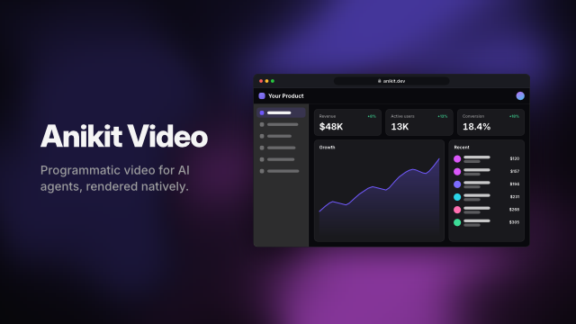
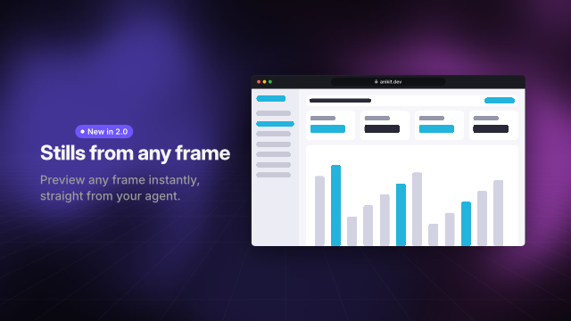
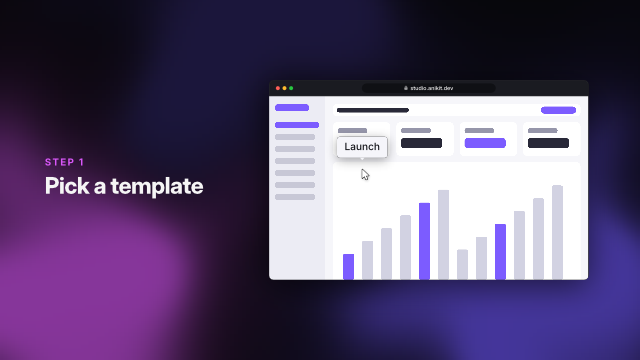
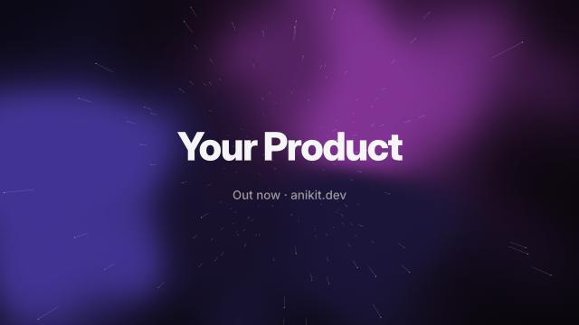
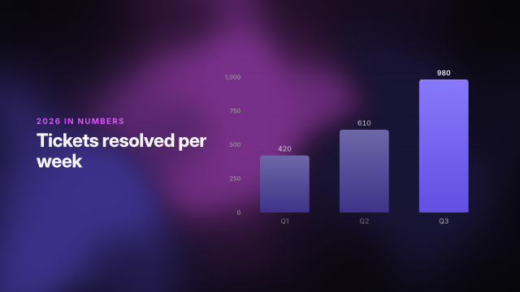
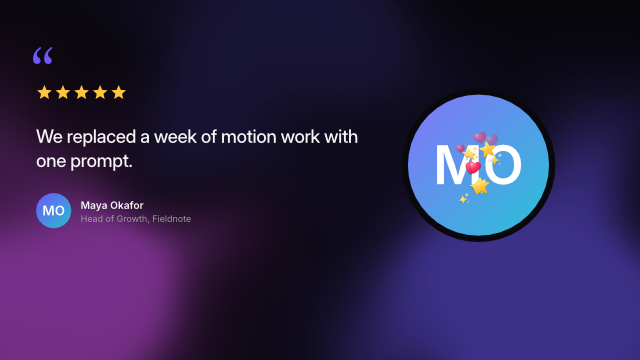
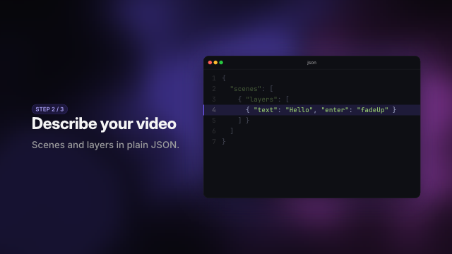
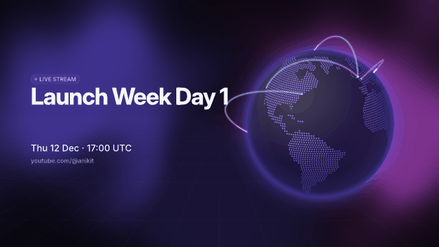
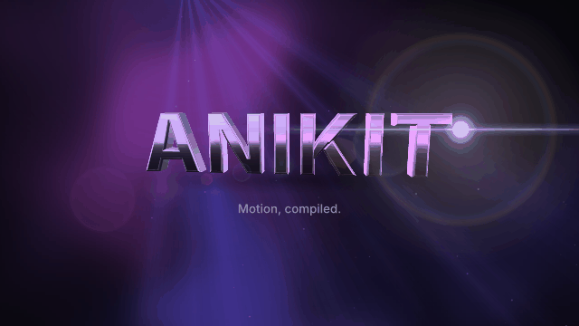

# Template gallery

Ten templates, each rendered with its example params (16:9, default brand). Only the listed params are required; everything else, including the visuals, has defaults. Each template also adapts to `--format 9:16 | 1:1` and to a brand kit (`--brand brand.json`).

## Product launch · `launch`



A 15–35 s launch film on a living brand mesh: optional kinetic hook, product reveal in a browser (your screenshot or a generated UI), 2–4 split-screen feature beats (device, code editor or screenshot with a success toast), an animated proof counter with a rising chart, and a CTA button that bursts into confetti.

```bash
echo '{"tagline": "Programmatic video for AI agents, rendered natively.", "features": [{"title": "No headless browser"}, {"title": "Built for agents"}]}' > p.json
anikit-video templates expand launch p.json --brand brand.json -o spec.json && anikit-video render spec.json -o launch.mp4
```

## Feature announcement · `feature`



A 12–20 s spotlight on one new feature: a 'New' badge and kinetic headline beside the product in a browser (your screenshot or a generated UI), the points checking off next to it with a success toast, then a CTA that bursts into confetti.

```bash
echo '{"headline": "Stills from any frame"}' > p.json
anikit-video templates expand feature p.json --brand brand.json -o spec.json && anikit-video render spec.json -o feature.mp4
```

## Changelog / what's new · `changelog`


A 12–25 s release recap: a version badge and kinetic title beside the product UI, then the changes as icon cards (New ✦, Improved ⚡, Fixed ✓) building in three at a time, then a CTA with confetti.

```bash
echo '{"version": "v2.4", "items": [{"type": "new", "text": "Vertical video templates"}, {"type": "new", "text": "MCP server for agents"}, {"type": "improved", "text": "Faster still previews"}]}' > p.json
anikit-video templates expand changelog p.json --brand brand.json -o spec.json && anikit-video render spec.json -o changelog.mp4
```

## Product demo walkthrough · `demo`



A 15–35 s walkthrough: a kinetic title beside the product, then 2–5 steps, each a screenshot in a browser (or phone) with an animated cursor that glides to the click point, clicks with a ripple and shows a tooltip callout, then a CTA with confetti.

```bash
echo '{"title": "From prompt to video in 3 clicks", "steps": [{"image": "step1.png", "title": "Pick a template"}, {"image": "step2.png", "title": "Drop in your brand kit"}]}' > p.json
anikit-video templates expand demo p.json --brand brand.json -o spec.json && anikit-video render spec.json -o demo.mp4
```

## Social teaser (9:16 first) · `teaser`



A 6–12 s vertical teaser for Reels, TikTok and Shorts: one word per beat in huge kinetic type (pop, scramble, mask) on a living brand mesh, with punch-in camera hits, brand-colour flashes and glitch cuts, ending on the logo with a starfield and a burst of sparks.

```bash
echo '{"words": ["No browser.", "No waiting.", "Just", "JSON", "in.", "Video", "out."]}' > p.json
anikit-video templates expand teaser p.json --brand brand.json -o spec.json && anikit-video render spec.json -o teaser.mp4
```

## Data story · `data-story`



A 15–30 s data narrative on a living brand mesh: a kinetic headline over a rising area chart, 1–3 animated bar charts beside their conclusions (the key bar highlighted), a big counting stat, and a takeaway with a sparkline stat tile and its source.

```bash
echo '{"headline": "Support tickets fell by half this year", "charts": [{"title": "Tickets resolved per week", "bars": [{"label": "Q1", "value": 420}, {"label": "Q2", "value": 610}, {"label": "Q3", "value": 980}]}], "takeaway": "Faster answers mean fewer tickets come back."}' > p.json
anikit-video templates expand data-story p.json --brand brand.json -o spec.json && anikit-video render spec.json -o data-story.mp4
```

## Testimonial / quote · `testimonial`



1–3 customer quotes, each revealed word by word with stars and the author beside a large avatar with floating reactions; an optional 'loved by' hook with an avatar stack and a scrolling company strip; a gradient CTA end card with confetti.

```bash
echo '{"quotes": [{"quote": "We replaced a week of motion work with one prompt.", "author": "Maya Okafor"}]}' > p.json
anikit-video templates expand testimonial p.json --brand brand.json -o spec.json && anikit-video render spec.json -o testimonial.mp4
```

## Tutorial / code walkthrough · `tutorial`



A coding tutorial: a title beside an editor; then 2–6 split-screen steps, each a numbered badge, title and note beside a code editor that types itself (with highlighted lines) or a terminal for one-line shell commands; then a checklist recap and a CTA with confetti.

```bash
echo '{"title": "Render a video from JSON in 3 steps", "steps": [{"title": "Install the CLI", "code": "cargo install anikit-video"}, {"title": "Describe your video", "code": "{\n  \"scenes\": [\n    { \"layers\": [\n      { \"text\": \"Hello\", \"enter\": \"fadeUp\" }\n    ] }\n  ]\n}"}]}' > p.json
anikit-video templates expand tutorial p.json --brand brand.json -o spec.json && anikit-video render spec.json -o tutorial.mp4
```

## Event countdown · `countdown`



An event countdown: kicker badge, event, date and place beside a spinning globe with live arcs; a big N…1 countdown with glowing rings that draw each second and a spark burst at zero; then a particle-text 'Live now' with confetti, or a save-the-date card.

```bash
echo '{"event": "Launch Week Day 1"}' > p.json
anikit-video templates expand countdown p.json --brand brand.json -o spec.json && anikit-video render spec.json -o countdown.mp4
```

## Logo reveal / intro · `logo-reveal`



A 3–6 s brand sting: a chrome 3D wordmark (or your logo) revealed with god rays and a lens flare (glow), dropping in with sparks (draw), assembled from particles (assemble), or matte and calm (minimal), plus an optional tagline.

```bash
echo '{}' > p.json
anikit-video templates expand logo-reveal p.json --brand brand.json -o spec.json && anikit-video render spec.json -o logo-reveal.mp4
```
