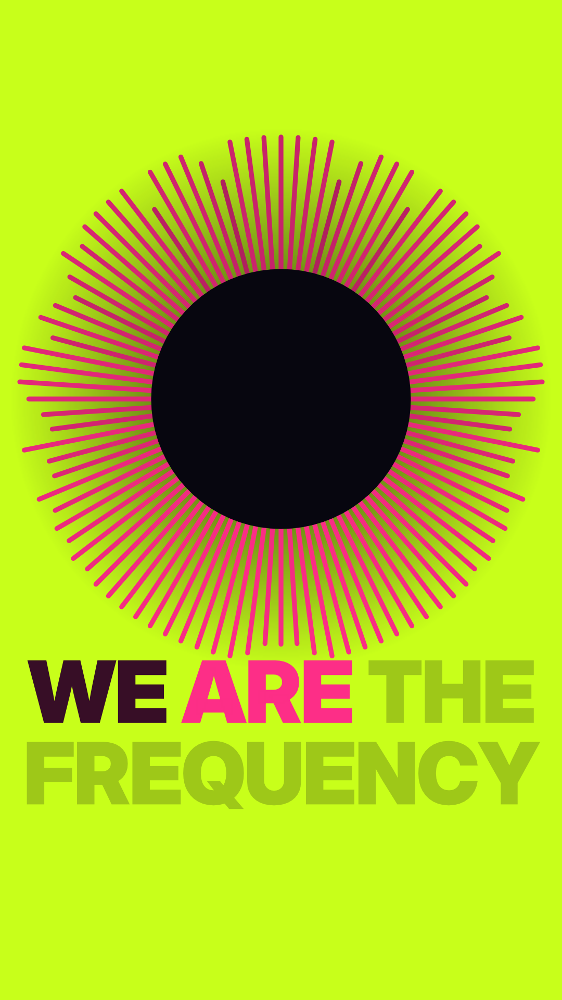

# Pulse

A 36-second vertical (1080×1920, 30 fps) kinetic-typography music video, made from one JSON spec and an original soundtrack. There is no browser and no video editor involved.



| File | What it is |
|---|---|
| `spec.json` | The whole video: 12 scenes, about 60 layers, every cut and word placed on the beat with `"@beatN"` / `"@barN"` markers |
| `soundtrack.py` | Synthesises the track: kick, clap, hats, sidechained saw bass, pad, a lead hook with dotted-eighth echo, a snare-roll build and a riser, at 120 BPM over 18 bars. Pure numpy; ffmpeg converts it to FLAC |
| `pulse.flac` | The generated soundtrack (3.7 MB) |
| `sync_check.py` | Lists every cut and word reveal against the detected beat grid |
| `poster.png`, `sheet.png` | A still at 18.6 s and a 24-frame contact sheet |

## Commands

From the repository root:

```bash
cargo build --release -p anikit-video
python3 examples/video/pulse/soundtrack.py                 # regenerate pulse.flac (2 s)
target/release/anikit-video beats examples/video/pulse/pulse.flac
target/release/anikit-video check examples/video/pulse/spec.json
target/release/anikit-video sheet examples/video/pulse/spec.json -o sheet.png --cols 8 --rows 3 --width 240
target/release/anikit-video render examples/video/pulse/spec.json -o pulse.mp4
python3 examples/video/pulse/sync_check.py
```

## Measured

These numbers come from a 4-core cloud VM (Intel Xeon @ 2.10 GHz) using the default `ak264` encoder plus AAC:

| | |
|---|---|
| Render wall time | **10.9 s** for 36 s of video (12.3 s including process start and audio analysis) |
| Render speed | **100 fps** (1080 frames, 3.3× real time) |
| Output | 34.1 MB MP4 (H.264 1080×1920 + AAC), mastered to −11.8 LUFS |
| Beat detection | 120.0 BPM; the grid is within 4 ms of the true beat |
| Sync | All 49 cuts and word reveals are within **3.4 ms** of a detected beat (one frame is 33 ms) |

## Structure (bar = 2 s)

| Time | Bars | Music | Picture |
|---|---|---|---|
| 0–4 | 1–2 | Filtered kick, pad, lead teaser | `PULSE` glitches in over a beat-pulsing dot grid; "TURN IT UP" karaoke, one word per beat |
| 4–12 | 3–6 | Verse: kick, bass, claps | One lyric per bar, cut on the downbeat: bars visualizer, radial visualizer, metaballs, diagonal grid; mask, pop, slide and drop styles |
| 12–16 | 7–8 | Snare roll and riser; the kick drops out on the last beat | `PULSE` forms from 7,000 particles while the camera creeps in; 4·3·2·1 lands on the last four beats |
| **16** | **9** | **Drop** | The palette flips from violet/cyan night to acid lime with ink and hot pink. The particle word bursts, a shockwave ring fires, confetti bursts, the camera shakes and `DROP` pops in, pulsing on every beat |
| 18–28 | 10–14 | Hook, sidechained bass | Radial visualizer with karaoke, shape morphs on every beat, one word per beat ("LOUDER THAN THE CITY"), metaballs with a waveform |
| 28–32 | 15–16 | Breakdown | God rays and slow metaballs; "FEEL IT IN YOUR CHEST" karaoke |
| 32–36 | 17–18 | Final hit and tail | Sparks, a lens-flare sweep and the wordmark; the credits land on beats 69 and 70 |

The camera zoom pulses on every beat with an expression: `"zoom": "=1 + 0.03 * exp(-7 * (gt * 2 - floor(gt * 2)))"`.

## Engine additions made for this film

These are small and additive, with tests and doc lines:

- **Beat markers.** `"@beat17"` and `"@bar9+0.5"` resolve to the beat grid detected in the spec's music track (`src/eval/beat_markers.rs`). The detector's grid is refitted to the onsets, which removed about 60 ms of drift over 36 s.
- **`anikit-video beats music.wav [--json]`** prints the tempo, beats and bars.
- **`particle-text`** has two new props:
  - `blend: "normal"` gives dark particles on a light background;
  - `stagger: 0` makes the exit a simultaneous burst instead of a left-to-right sweep.

`critique` reports one contrast error at `DROP`. It is a false positive: the critic compares the text with the scene's dark background, but the text sits on the lime layer that slams in at the drop.
